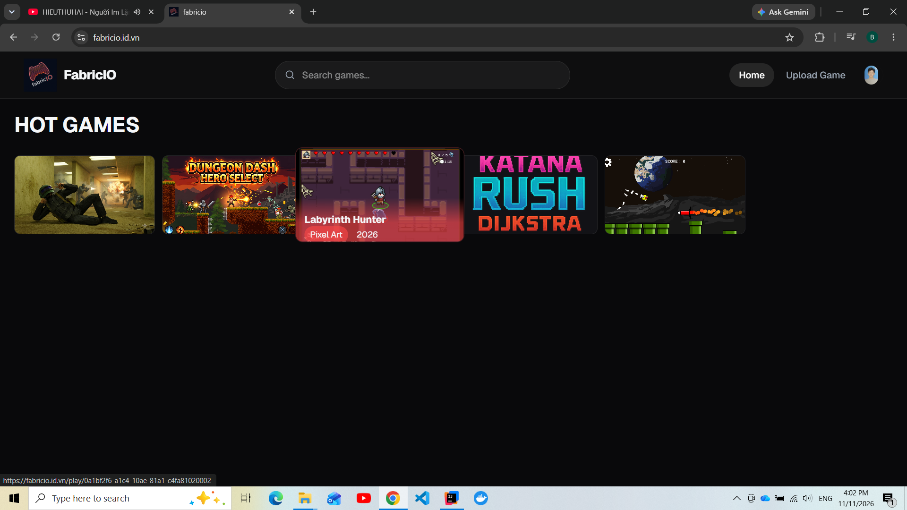
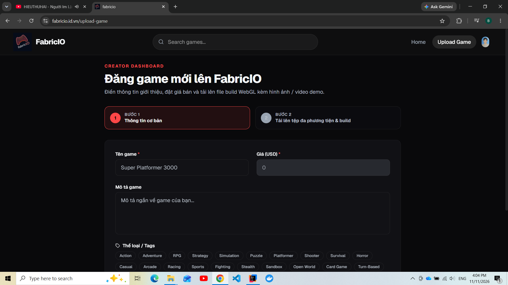

# FabricIO – Web Gaming Platform

FabricIO is a full-stack web platform where developers publish games and tools, and players discover, play, rate and favorite them. The backend is a **Spring Boot modular monolith** (migrated from a .NET N-tier design) backed by PostgreSQL and S3-compatible object storage.

**Live demo:** https://fabricio.id.vn

> The project was initially deployed on AWS using the Free Tier. After the free-tier period expired, the infrastructure was migrated to Render and Cloudflare to keep hosting costs minimal. Currently, Continuous Deployment (CD) is temporarily disabled, while Continuous Integration (CI) remains active.

---

## Features

- **Authentication & authorization:** JWT-based login with role-based access control.
- **Game publishing:** Developers submit games with metadata, tags, cover images and downloadable or playable assets.
- **Media storage:** Avatars and game assets are stored in object storage behind a storage interface (MinIO locally, Cloudflare R2 in production).
- **API documentation:** Interactive Swagger / OpenAPI UI.

## Screenshots





---

## Demo

[](https://youtu.be/j8uGtnIP4t0)

> **[Xem Video Demo trên YouTube (00:54)](https://youtu.be/j8uGtnIP4t0)**

---

## Tech Stack

| Layer | Technologies |
| :---- | :----------- |
| Frontend | React, TypeScript, Vite, Tailwind CSS, shadcn/ui, Axios, Context API |
| Backend | Java 21+, Spring Boot, Spring Security, JWT, Gradle |
| Database | PostgreSQL |
| Object storage | MinIO (local/dev), Cloudflare R2 (production), both via the S3 API |
| Testing | JUnit, Mockito (backend), ESLint (frontend), k6 (load testing) |
| DevOps | Docker, Docker Compose, Nginx (reverse proxy on aws), GitHub Actions (CI) |
| Hosting | Cloudflare Pages (frontend), Render (backend, Docker), Cloudflare R2 (storage) |

---

## Architecture

The backend follows a **Modulith architecture**, with each module adopting a lightweight DDD approach. Modules are structured into four layers: `web` for thin controllers, `application` for services, handlers and DTOs, and `domain` for rich domain entities, exception and repository abstractions. Each module encapsulates its own business logic and domain model.

```text
                ┌──────────────────┐
  Browser ────► │ Cloudflare Pages │  React + TypeScript
                └────────┬─────────┘
                         │ REST + JWT
                ┌────────▼─────────┐
                │ Render (Docker)  │  Spring Boot modular monolith
                │  auth · users    │
                │  games           │
                │  interactions    │
                │  purchases       │
                └───┬──────────┬───┘
                    │          │
          ┌─────────▼──┐   ┌───▼──────────────┐
          │ PostgreSQL │   │ Cloudflare R2    │
          └────────────┘   │ (MinIO locally)  │
                           └──────────────────┘
```

### Backend modules

| Module | Responsibility |
| :----- | :------------- |
| `auth` | Authentication, JWT, sessions, `UserPrincipal` |
| `users` | Accounts, roles and permissions |
| `games` | Games, tags, media |
| `shared` | Cross-cutting config: storage (MinIO/S3), security, exception handling, base classes |

---

## Project Structure

```text
FabricIO
├─ backend/                  # Spring Boot (Java)
│  ├─ src/main/java/fabricio/backend
│  │  ├─ modules/
│  │  │  ├─ auth/
│  │  │  │  ├─ web/          # Controllers
│  │  │  │  ├─ application/  # Services, handlers, DTOs
│  │  │  │  └─ domain/       # Entities, exceptions, repository abstractions
│  │  │  ├─ games/           # Same layout as auth
│  │  │  └─ users/           # Same layout as auth
│  │  └─ shared/             # Storage, security, exceptions, base classes
│  ├─ src/test/              # Unit tests and mock factories
│  └─ Dockerfile             # Backend image (also used by Render)
├─ frontend/                 # React + Vite + TypeScript
│  ├─ src/
│  │  ├─ components/         # auth, common, layouts, games, ui
│  │  ├─ context/            # AuthContext, GameContext
│  │  ├─ hooks/              # useAuth, useGame, useUser
│  │  ├─ pages/              # Home, Games, Play, Profile, SubmitGame
│  │  └─ services/           # Axios API client
│  └─ Dockerfile
├─ docker/                   # Docker Compose files (dev, local, prod)
├─ nginx/                    # Nginx reverse proxy configuration
└─ .github/                  # GitHub Actions workflows (CI)
```

---

## Getting Started (Local Development)

### Prerequisites

- Docker and Docker Compose v2
- Java 21+ (only to run the backend without Docker)
- Node.js 20+ (only to run the frontend without Docker)

### Run with Docker

**1. Create environment files**

```bash
cp frontend/.env.example frontend/.env
cp backend/.env.example backend/.env
```

Review the values in both files before starting. The `.env.example` files document every variable.

**2. Start the full stack**

```bash
docker compose -f docker/docker-compose.local.yml up --build
```

### Services and ports

| Service | URL | Notes |
| :------ | :-- | :---- |
| Nginx (main entry point) | http://localhost:5000 | Reverse proxy for the whole stack |
| Frontend (Vite, HMR) | http://localhost:5173 | React dev server |
| Backend API | http://localhost:8080 | Spring Boot REST API |
| Swagger UI | http://localhost:8080/swagger-ui/index.html | Explore and test endpoints |
| MinIO Console | http://localhost:9001 | Local object storage. Credentials are defined in the local Docker Compose / `.env` files. Use for development only. |

### Run without Docker (optional)

```bash
# Backend
cd backend
./gradlew bootRun

# Frontend
cd frontend
npm install
npm run dev
```

You will still need a running PostgreSQL instance and an S3-compatible store (for example MinIO) configured in `backend/.env`.

---

## Testing

**Backend** (JUnit + Mockito):

```bash
cd backend
./gradlew test
```

**Frontend** (ESLint):

```bash
cd frontend
npm run lint
```

---

## Performance

Each optimization step was load-tested with [k6](https://k6.io/) (20 virtual users) and tagged in git (`bench-b0` to `bench-b3`), so every change can be compared against the previous baseline. All runs finished with a 0% error rate.

| Milestone | Scenario | p50 (ms) | p95 (ms) | p99 (ms) | Req/s | Notes |
| :-------- | :------- | -------: | -------: | -------: | ----: | :---- |
| **B0** `bench-b0` | game-detail | 25.2 | 35.0 | 44.2 | 759.4 | Baseline. N+1 query problem |
| | games-search | 209.1 | 256.7 | 326.2 | 92.5 | Baseline |
| | games-list-deep | 265.5 | 337.6 | 399.5 | 72.9 | Baseline |
| | games-list | 230.5 | 312.5 | 385.6 | 82.4 | Baseline. N+1 (1 games query + 1 count + 43 media/tags queries) |
| **B1** `bench-b1` | game-detail | 13.4 | 19.0 | 23.1 | 1402.9 | Removed heavy media table joins |
| | games-search | 140.8 | 167.2 | 195.9 | 138.8 | Optimized DTO mapping |
| | games-list-deep | 197.8 | 234.3 | 280.0 | 100.0 | Optimized DTO mapping |
| | games-list | 152.4 | 183.5 | 226.5 | 127.4 | Reduced N+1 queries |
| **B2** `bench-b2` | game-detail | 13.7 | 18.7 | 22.2 | 1399.9 | Performance held |
| | games-search | 201.3 | 244.2 | 318.3 | 96.9 | Slight regression |
| | games-list-deep | 1619.6 | 1939.4 | 2601.3 | 12.3 | **Regression:** `@EntityGraph` caused heavy in-memory pagination |
| | games-list | 1624.0 | 2083.8 | 3745.2 | 12.0 | **Regression:** `@EntityGraph` caused heavy in-memory pagination |
| **B3** `bench-b3` | games-list-deep | 137.4 | 163.1 | 199.6 | 145.0 | Removed `@EntityGraph`, switched to a **2-phase query** |
| | games-list | 94.6 | 119.5 | 148.2 | 202.3 | Removed `@EntityGraph`, switched to a **2-phase query** |

---

## CI/CD and Deployment

**Continuous integration (GitHub Actions)** runs on every push:

- Frontend: ESLint
- Backend: unit tests

**Deployment**

| Component | Platform | How |
| :-------- | :------- | :-- |
| Frontend | Cloudflare Pages | Built from the repository |
| Backend | Render | Docker image built from `backend/Dockerfile` |
| Object storage | Cloudflare R2 | S3-compatible API, same code path as MinIO locally |

Automated deployment from GitHub Actions has been retired in favor of the platform-native deployments above.

---

## Contributing

### Branching

| Branch | Purpose |
| :----- | :------ |
| `main` | Production |
| `staging` | Integration and pre-production testing |
| `feature/<name>` | New features |
| `fix/<name>` | Bug fixes |
| `hotfix/<name>` | Urgent fixes on `main` |

### Commit messages

This project follows [Conventional Commits](https://www.conventionalcommits.org/):

```text
<type>(<scope>): <short description>
```

Common types:

- `feat`: a new feature, e.g. `feat(auth): add JWT login`
- `fix`: a bug fix, e.g. `fix(storage): handle duplicate file names on upload`
- `chore`: tooling, config or CI changes, e.g. `chore(ci): add backend unit test job`
- `refactor`: code changes that neither fix a bug nor add a feature
- `docs`, `test`, `perf`: documentation, tests and performance work

---

## Author

**Nguyen Thanh Binh** – [GitHub](https://github.com/Binh05)
