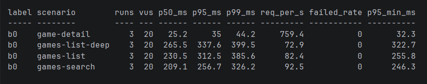

# Kết quả benchmark FabricIO

## Môi trường (điền một lần, giữ nguyên giữa các lần đo)

- Máy: CPU / RAM / SSD, chế độ nguồn (cắm điện, High performance)
- OS / Java / Spring Boot / PostgreSQL:
- Cách chạy app: `java -jar ...`, profile, heap (`-Xmx`), log SQL tắt
- Dữ liệu: số user / game (đã xóa) / media / tag / tag map = ...
- k6: VUS=20, warmup 30s, đo 2m, 3 lần, lấy lần giữa theo p95 (`benchmark/run-all.ps1`)

## Bảng so sánh

| Mốc | Git tag | Kịch bản | p50 (ms) | p95 (ms) | p99 (ms) | req/s | Lỗi | Query/request | Ghi chú |
|---|---|---|---|---|---|---|---|---|---|
| B0 | bench-b0 | games-list | 230.5 | 312.5 | 385.6 | 82.4 | 0% | 45 | Median run (3 runs, 20 VUs). Bị lỗi N+1 (1 query games + 1 count + 43 queries media/tags) |
| B0 | bench-b0 | games-list-deep | 265.5 | 337.6 | 399.5 | 72.9 | 0% | | Median run (3 runs, 20 VUs) |
| B0 | bench-b0 | games-search | 209.1 | 256.7 | 326.2 | 92.5 | 0% | | Median run (3 runs, 20 VUs) |
| B0 | bench-b0 | game-detail | 25.2 | 35.0 | 44.2 | 759.4 | 0% | | Median run (3 runs, 20 VUs) |

